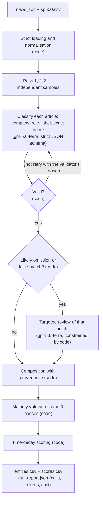
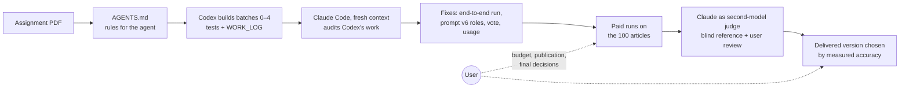

# Architecture

## 1. Pipeline

### What the code does, what the model does, and why

| Step | Owner | Why |
| --- | --- | --- |
| Reading, schemas, dates, Unicode, share classes | Code | Deterministic and testable |
| Finding the companies, brand → parent, role, label | `gpt-5.6-terra` | Needs reading comprehension in context |
| Neutral label for "rating issuer", "source", "comparison", "other mention" | Schema + model | The assignment defines these as neutral; the schema makes another label impossible |
| Validation of every answer (universe, roles, exact quote, duplicates) | Code | A model answer is not trusted data |
| Flagging likely omissions and false matches (`entity_aliases.json`) | Code | Cheap and reproducible; only triggers a review |
| Vote, weights, sums, CSV writing | Code | Fixed formula, reproducible arithmetic |
| Measuring accuracy | Second-model judge + user, scored by code | Structure does not prove a label is right |

The model never computes the score, never sees other articles and has no tools.

### Key design choices

- **Whole article + full company list per request**, no lexical prefilter: a prefilter
  would lose brands and subsidiaries (Waymo, CNBC, iShares…).
- **Roles before labels** (prompt `entity-sentiment-v6-roles`): most errors of earlier
  prompts were on the border between "implication" and "mere mention" (a bank issuing a
  downgrade labelled negative, a peer's small move labelled positive).
- **Fail closed**: invalid answers are retried with a bounded number of attempts, never
  replaced by `neutral`; a network error or unknown cost stops the run; reviews in
  `additions-only` mode cannot remove or relabel anything.
- **Three passes and a vote**: the three passes agree on 93.7 % of pairs; the vote removes
  one-off mistakes and gives an agreement level per pair, for about 1.5 times the cost of one
  pass (passes 2–3 reuse the provider's prompt cache).
- **Everything traceable**: each run directory keeps every pass, review, vote and manifest
  with input hashes; `results/` is a byte-identical copy of the delivered run.

### Modules (`src/aie2609/`)

| Module | Responsibility |
| --- | --- |
| `cli.py` | Subcommands (`run`, `usage`, `audit`, diagnosis and review tools) |
| `ingestion.py`, `normalization.py`, `dates.py`, `audit.py` | Strict loading, U+200B removal on a copy, New York time |
| `classification.py` | Prompt, JSON schema, `validate_entities` |
| `llm.py` | Minimal HTTPS client (standard library), no redirects, no fallback model |
| `runner.py` | Cache, bounded retries with validator feedback, budget, checkpoints |
| `review.py`, `composition.py`, `entity_aliases.json` | Coverage alerts, targeted review, composition |
| `pipeline.py` | The `run` command: passes, vote, export, run report |
| `scoring.py` | Time-decay formula and CSV export |
| `usage.py` | Prices, token accounting, budget, usage summary |
| `reference.py`, `evaluation.py` | Accuracy reference and per-version scoring |

### Cost

Measured per attempt from the API's own token counts, priced at 2 / 0.20 / 2.50 / 12 USD per
million tokens (input / cache read / cache write / output, checked 12 October). One cold pass
costs **0.030 USD per article**, 86 % of it writing the ~14k-token common prefix to the
provider cache; passes 2–3 read it back for ~0.006 USD per article. A budget is reserved
before each call and the run stops before exceeding `--max-cost-usd`.

## 2. How the project was built

1. **Rules first.** The user gave Codex its rules in `AGENTS.md`, derived from the PDF:
   business constraints, model and budget rules, a batch loop with tests and a dated log
   entry for every step.
2. **Build with Codex** (12–13 October): ingestion, classification client, validation,
   cache, budget, review, composition and scoring, each batch tested offline and logged.
3. **Audit with Claude Code** (14 October), deliberately a different agent with a fresh
   context, like an LLM-as-judge over the first agent's work. It found that the evaluators
   could not run the pipeline in one command and that the submitted CSV files could not be
   reproduced by the code; `CLAUDE.md` records that role.
4. **Fix and measure.** End-to-end `run`, usage reporting, prompt v6 with roles, three passes
   with a vote; then every version was scored on a blind reference that Claude adjudicated
   as a second model and the user reviewed. The best measured version was delivered.

The full trace (commands, costs, failures, decisions) is in [`docs/WORK_LOG.md`](docs/WORK_LOG.md).
