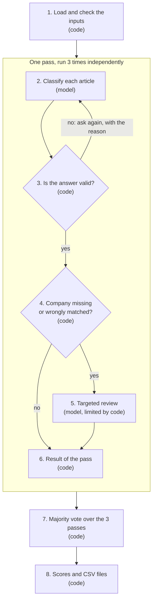
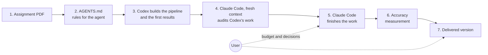

# Architecture

This page explains how the pipeline works (part 1) and how the project itself was built with
two coding agents (part 2). Every step is labelled **code** (deterministic Python) or
**model** (`gpt-5.6-terra`).

## Part 1 — The pipeline

The examples below are real cases from the delivered run.

### 1. Load and check the inputs — code

- **In:** `news.json` (100 articles) and `sp500.csv` (503 rows).
- **What happens:** both files are checked strictly (missing fields, duplicate ids, bad dates,
  malformed rows) and rejected with a clear error if invalid. Invisible characters are removed
  from an in-memory copy: in N027 the name is written `Te<U+200B>sla` with a zero-width space. The two
  share classes of the same company are merged (`GOOG` → `GOOGL`, `FOX` → `FOXA`, `NWS` → `NWSA`).
- **Out:** 100 clean articles and a list of 500 companies. The original files are never modified.

### 2. Classify each article — model

- **In:** one request per article with the instructions, the full list of 500 companies and the
  article (headline, body, date).
- **What happens:** the model lists every company of the list that the article mentions,
  directly or through a brand (YouTube → Alphabet, The Wall Street Journal → News Corp). For each
  one it gives a **role**, a **label** and an **exact quote** from the article.
- **Out**, for N001 *"Fidelity National Information Services Shares Fall After Wells Fargo Downgrade"*:

  | Ticker | Role | Label | Quote (shortened) |
  | --- | --- | --- | --- |
  | FIS | subject | negative | "FIS reduced its Capital Markets segment revenue growth forecast…" |
  | FISV | affected_peer | negative | "peer Fiserv encountering its own guidance challenges…" |
  | WFC | rating_issuer | neutral | "Wells Fargo downgraded the financial technology company…" |
  | MS | rating_issuer | neutral | "UBS, Barclays, Morgan Stanley … reduced their price targets" |

- **Why roles:** the assignment says the bank issuing a rating, a media source, a customer, a
  location or a size comparison are *neutral*. The role says why a company is named, and the
  answer format only allows `neutral` for those roles: Wells Fargo cannot be labelled negative
  just because it wrote a downgrade.

### 3. Is the answer valid? — code

- **What happens:** the answer must follow the exact format; every ticker must be in the list;
  every quote must appear word for word in the article; no company twice; no non-neutral label
  for a neutral role.
- **If not:** the model is asked again, with the exact reason of the rejection (at most 3
  attempts). Example: in N064 the model paraphrased a quote; the second attempt, told that the
  quote was not exact, succeeded. An error is never replaced by `neutral`.

### 4. Company missing or wrongly matched? — code

- **What happens:** the code searches the article for names it can recognise reliably: company
  names from the CSV and a short list of brands and publications found in the data
  (`entity_aliases.json`: CNN → WBD, Wall Street Journal → NWSA, iShares → BLK…). It also knows
  a few false matches to forbid (the social network "X" is not Block, ticker XYZ).
- **Examples:** N013 mentions CNN but the model did not list Warner Bros. Discovery → flagged.
  In N100 the model linked "X" to Block → flagged.
- **Why:** the code is good at spotting a name, not at judging its implication. It never adds or
  changes anything itself; it only sends the article to step 5.

### 5. Targeted review — model, limited by code

- **In:** the flagged article, the model's first answer and the alert.
- **What happens:** the model reviews only that article. For a missing company it runs in
  "additions only" mode: the code rejects any answer that removes a company or changes an
  existing label. For a forbidden match it may remove the wrong company.
- **Examples:** N013 → WBD added as `neutral` (CNN is only a source). N100 → XYZ removed.
  Between 11 and 15 of the 100 articles needed a review in each pass.

### 6. Result of the pass — code

The 100 final answers of the pass are assembled, recording for each article whether it comes
from step 2 or from a review. A remaining alert is kept and reported, never hidden.

### Why 3 passes?

The model is not fully deterministic: on a borderline case it may answer `neutral` once and
`negative` the next time. Steps 2 to 6 therefore run three times, each pass starting from
scratch (each has its own cache entry). The three passes agreed on 93.7 % of the
article/company pairs.

### 7. Majority vote over the 3 passes — code

For each article/company pair, the answer given by at least 2 of the 3 passes is kept.

| Example | Pass 1 | Pass 2 | Pass 3 | Kept |
| --- | --- | --- | --- | --- |
| PCG in N020 | neutral | neutral | negative | neutral |
| INTC in N026 | negative | negative | neutral | negative |
| BBY in N099 ("Bloomberg" mistaken for Best Buy) | — | — | neutral | removed |

On the 100 articles: 224 pairs unanimous, 9 decided 2 to 1, 6 pairs seen by a single pass removed.

### 8. Scores and CSV files — code

- Each article gets a weight that halves every 7 days before 29 September 2026, 00:00 New York
  time. N001 was published 34.7 days earlier, so its weight is 0.5^(34.7/7) ≈ 0.032.
- Each label counts +1, 0 or −1, multiplied by that weight: FIS gets −0.032 from N001, Wells
  Fargo 0.
- A ticker's score is the sum over all its articles.
- **Out:** `entities.csv` (one row per article/company), `scores.csv` (one row per ticker) and
  `run_report.json` (what happened in each pass, calls, tokens, cost). Everything goes into a
  new folder `output/run-<timestamp>/`, so no run ever overwrites another.

### Code or model, and why

| Done by code | Done by the model |
| --- | --- |
| Reading and checking files, dates, share classes | Understanding which companies an article is about |
| Checking every answer, asking again if invalid | Mapping brands to their parent company |
| Spotting likely missing or wrong companies | Choosing each company's role and label |
| Majority vote, weights, sums, CSV files, cost tracking | Reviewing a flagged article |

The model never computes a score, never sees other articles and has no tools. Every step in
code is covered by offline tests with a fake model.

### Where it lives (`src/aie2609/`)

| Step | Module |
| --- | --- |
| 1 | `ingestion.py`, `normalization.py`, `dates.py` |
| 2–3 | `classification.py` (prompt, format, validation), `llm.py` (API client), `runner.py` (retries, cache, budget) |
| 4–6 | `review.py`, `composition.py`, `entity_aliases.json` |
| 3 passes, 7 | `pipeline.py` (the `run` command) |
| 8 | `scoring.py`; costs in `usage.py` |
| Accuracy measurement | `reference.py` |

### Cost

Each call is priced from the token counts returned by the API. One pass costs about
**0.030 USD per article**: most of it is the ~14,000-token part common to every request (the
instructions and the 500 companies). Passes 2 and 3 reuse that part from OpenAI's cache and cost
about 0.006 USD per article, so the delivered 3-pass run costs about 0.045 USD per article. A
budget is reserved before every call and the run stops before exceeding `--max-cost-usd`.

## Part 2 — How the project was built

1. **Assignment PDF** — the single source of requirements.
2. **AGENTS.md** — the user turned the PDF into rules for the coding agent: what is allowed
   (only the two input files, only `gpt-5.6-terra`, no manual edit of results), how to handle the
   key and the budget, and a working loop where every step ends with tests and a dated entry in
   [`docs/WORK_LOG.md`](docs/WORK_LOG.md).
3. **Codex builds the pipeline and produces the first results** (12–13 October), in small
   batches: input checks, model client, answer validation, cache and budget, reviews, scoring,
   then the first `entities.csv` and `scores.csv` on the 100 articles.
4. **Claude Code takes over with a fresh context** (14 October). A different agent was chosen
   deliberately to get an independent second opinion, much like an LLM-as-judge, since an agent
   reviewing its own work shares its blind spots. Its audit of Codex's work found that the
   evaluators could not run the pipeline with one command and that the first results could not
   be reproduced by the code. Its rules are in [`CLAUDE.md`](CLAUDE.md), which reuses `AGENTS.md`.
5. **Claude Code finishes the work** — the one-command `run`, cost reporting, the roles in the
   prompt and the 3-pass vote, each tested offline, then run on the 100 articles within a budget
   set by the user.
6. **Accuracy measurement** — every version was compared on all the cases where versions
   disagree plus random checks. Here Claude acts as an LLM-as-judge in the strict sense: it judged
   the model's outputs as a second model, and the user reviewed all 21 debatable cases
   ([`review/reference-v1`](review/reference-v1/README.md)).
7. **Delivered version** — the one with the best measured accuracy (0.933), copied to
   [`results/`](results/README.md).
